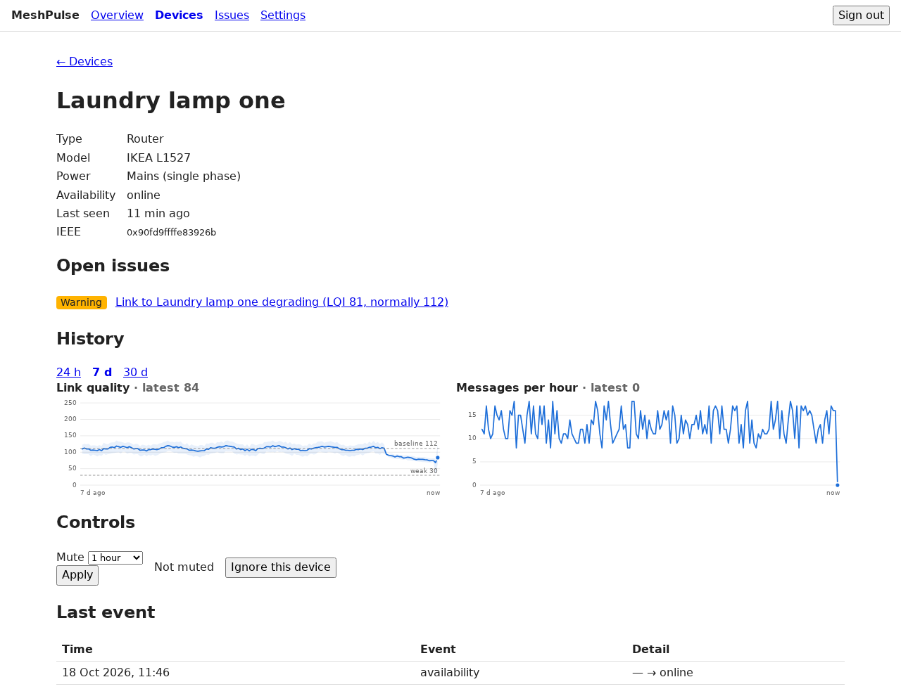
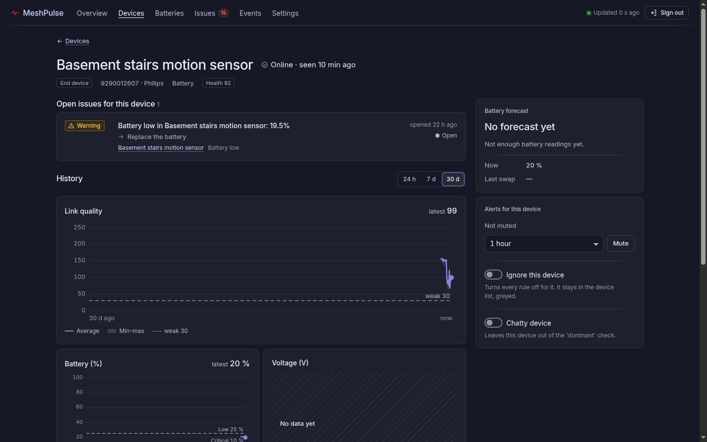
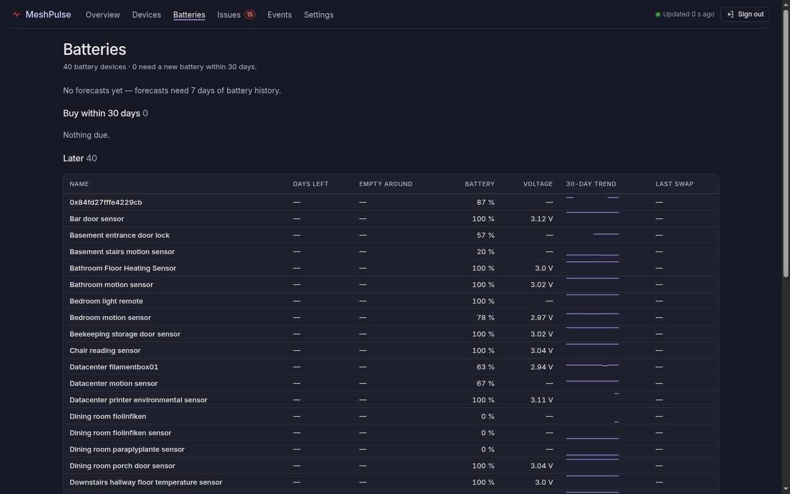

# MeshPulse

MeshPulse is a passive health monitor for Zigbee2MQTT. It watches the MQTT traffic of your Zigbee mesh, raises issues such as offline or silent devices, flapping devices, low batteries, an offline or restarting bridge, a lost MQTT connection and an open network, and notifies you on Discord. It never publishes to MQTT, so it can't change anything on your network.


## Device and Batteries pages

Select a device on the **Devices** page to open its page (`/devices/<ieee>`). It shows link quality, battery, voltage, and messages-per-hour charts over 24 hours, 7 days, or 30 days, plus the battery forecast, recent events, and a mute control. **Ignore this device** stops all rules for that device.





The **Batteries** page is a shopping list. It marks devices as **Low now** or **Due soon**, and shows the forecast days left, the last battery swap, and a 30-day sparkline.



## Trend rules

These rules work from hourly rollups of link quality, battery, and message counts.

| Rule | Raises an issue when | Defaults |
| --- | --- | --- |
| Weak link (`lqi.weak`) | The 24-hour average link quality (LQI) is low. Never Critical. | Below 30 |
| Degrading link (`lqi.degrading`) | The 24-hour average is below the device's own 7-day baseline. | 25% below |
| Route failures (`route.failures`) | Commands to a device fail. Failed availability pings and commands sent while the device is offline don't count for a single device. | 5 in 24 hours: Warning; 20: Critical |
| Network route errors (`network.route_errors`) | Route errors across the network exceed the normal hourly rate. | More than 3 times normal and at least 10 per hour |
| Battery forecast (`battery.forecast`) | The battery is forecast to reach 10% soon. Shown in the interface only; it never notifies. | 21 days |

Needs history: the first rollup appears after the first full hour. Degrading link and network route errors start after 3 days of history, and the battery forecast needs 7 days since the last battery swap. You can change every threshold in the **Thresholds** section of **Settings**.

Tip: a device whose link is permanently weak sends a Warning reminder every 24 hours. To stop the reminders, acknowledge the issue or ignore the device.

## Requirements

- Zigbee2MQTT 2.x publishing to an MQTT broker.
- An MQTT user with **subscribe** access to `zigbee2mqtt/#`. Read-only is enough.
- Docker with Compose.

## Configure Zigbee2MQTT

Add these settings to Zigbee2MQTT's `configuration.yaml` and restart it. MeshPulse shows a warning banner for any that are missing.

```yaml
availability:
  enabled: true
health:
  interval: 10
  reset_on_check: false
advanced:
  log_level: info
```

Zigbee2MQTT 2.x always publishes its log on `bridge/logging`, so no `log_output` change is needed. On Zigbee2MQTT 1.x, add `mqtt` to `advanced.log_output`. The route-failure rules read this log.

If you run the Home Assistant add-on, these settings go in Zigbee2MQTT's own `configuration.yaml` (or its web UI under **Settings**), not on the add-on's Configuration tab, which only accepts the add-on's own options.

## Set up

1. Copy the example environment file and edit it:

   ```sh
   cp .env.example .env
   openssl rand -base64 32   # paste into SECRET_KEY
   ```

   Set at least `MQTT_URL`, `SECRET_KEY`, `ADMIN_EMAIL` and `ADMIN_PASSWORD`.

2. Start the container:

   ```sh
   docker compose up -d --build
   ```

3. Open `http://<host>:3000` and sign in with `ADMIN_EMAIL` and `ADMIN_PASSWORD`. The account is created on first start. Sign-up is disabled.

The database lives in the named Docker volume `meshpulse-data`, which Docker lists as `<project>_meshpulse-data` (for example `meshpulse_meshpulse-data`). SQLite runs in WAL mode, so recent writes may sit in `meshpulse.db-wal` until the app stops. To back up, stop the container first, copy the database, then start it again:

```sh
docker compose stop meshpulse
docker compose cp meshpulse:/data/meshpulse.db ./backup.db
docker compose start meshpulse
```

The container reports `healthy` about 60 to 90 seconds after start, once the first rules run.

## Deploy with Dokploy

1. Create a Compose application from this repository. Dokploy builds the image from the `Dockerfile`.
2. Add the variables from `.env.example` in the environment tab.
3. The named volume `meshpulse-data` (declared in `docker-compose.yml`) keeps the database across redeploys. Do not remove it.
4. Add a domain and set `PUBLIC_URL` to the exact URL you open, for example `https://meshpulse.example.com`. Use `https` there so session cookies are marked Secure, and always open MeshPulse through that URL. Opening `http://host:3000` instead makes login fail silently, because the browser drops the Secure cookie.
5. Behind the proxy, set `ADDRESS_HEADER=x-forwarded-for` and `XFF_DEPTH=1`. Otherwise the login rate limiter sees every user as the proxy's IP. The image already sets `PROTOCOL_HEADER=x-forwarded-proto`; add `HOST_HEADER=x-forwarded-host` if the proxy rewrites the host.

## Deploy on Unraid

1. Build the image on the server (there is no published image yet; the repo is private, so clone with a GitHub token or copy the source over):

   ```sh
   git clone https://github.com/jumpingmushroom/MeshPulse /tmp/meshpulse
   docker build -t meshpulse:latest /tmp/meshpulse
   ```

1. Copy the template and generate a secret key:

   ```sh
   T=/boot/config/plugins/dockerMan/templates-user/my-MeshPulse.xml
   cp /tmp/meshpulse/unraid/meshpulse.xml "$T"
   sed -i "s#\(Target=\"SECRET_KEY\"[^>]*\)/>#\1>$(openssl rand -base64 32)</Config>#" "$T"
   ```

1. In **Docker > Add Container**, select **MeshPulse**, fill in the MQTT URL, broker user and admin login, and click **Apply**.

The container stores its database in `/mnt/user/appdata/meshpulse`. It starts as root only to take ownership of that folder, then runs as `PUID:PGID` (default `99:100`). To update, rebuild the image and restart the container.

## Discord notifications

1. In Discord, open the channel's **Edit Channel > Integrations > Webhooks** and create a webhook. Copy its URL.
2. In MeshPulse, open **Settings**, paste the URL, and select **Send test**.

## Apprise notifications

Apprise delivers to services such as ntfy, Telegram, Pushover, and email through an [apprise-api](https://github.com/caronc/apprise-api) server that you run.

1. In MeshPulse, open **Settings** and go to **Apprise**.
2. Enter the apprise-api URL.
3. Enter either a stored configuration key or one or more Apprise URLs. MeshPulse encrypts the URLs and doesn't show them again.
4. Select the minimum severity to send.
5. Save, then select **Send test**.

## Heartbeat

To get alerted when MeshPulse itself stops, create a **Push** monitor in Uptime Kuma and set `HEARTBEAT_URL` to its push URL. MeshPulse calls it every 60 seconds while MQTT and the rules loop are healthy.

## Tuning for the first week

- The default bridge silence threshold is 5 minutes. On a small or very quiet mesh, raise **Bridge silence** in **Settings**. It is the time without any device message before "Zigbee network silent" fires. Messages from Zigbee2MQTT itself (health, logs, availability) do not count.
- A Zigbee2MQTT restart that takes longer than 1 to 2 minutes raises `bridge.offline`. This is expected.

## Recording traffic

Record real `zigbee2mqtt/#` traffic to a JSONL file (one `{ts, topic, payload, retain}` object per line), usable later as test fixtures.

Environment variables: `MQTT_URL` (default `mqtt://localhost:1883`), `MQTT_USERNAME`, `MQTT_PASSWORD`, `Z2M_BASE_TOPIC` (default `zigbee2mqtt`).

```sh
MQTT_URL=mqtt://broker:1883 npm run capture [-- path/to/output.jsonl]
```

Output defaults to `captures/<ISO date>.jsonl`. Press Ctrl+C to stop.

## Development

```sh
npm install
npm run dev              # dev server
npm test -- --run        # tests, one shot
npm run check            # svelte-check
npx drizzle-kit generate # after schema changes
```
