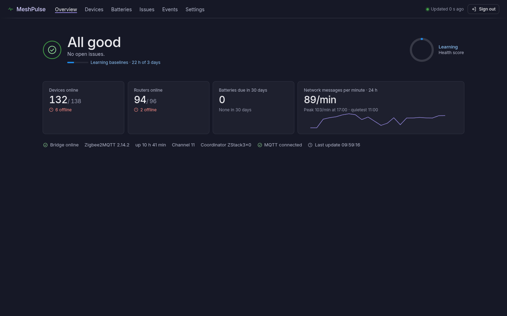
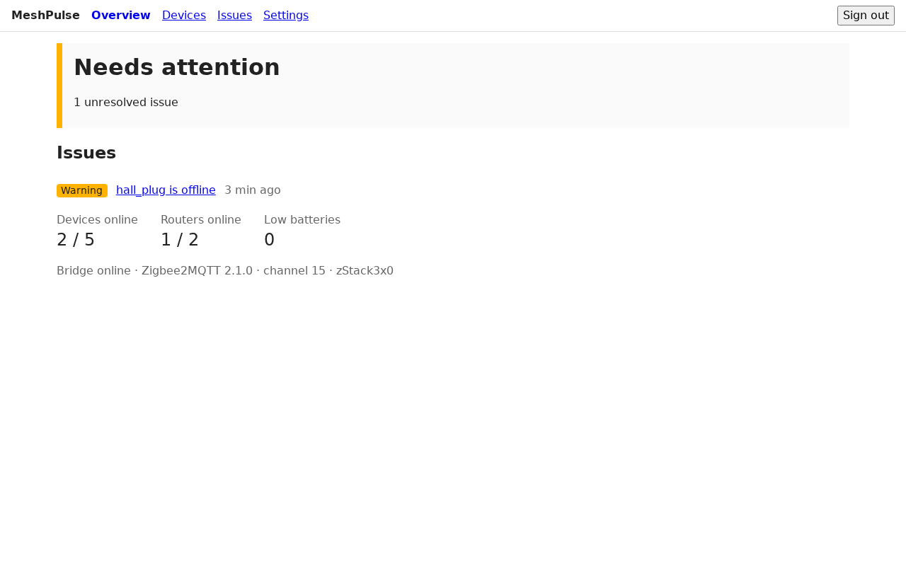

# MeshPulse

MeshPulse is a passive health monitor for Zigbee2MQTT. It watches the MQTT traffic of your Zigbee mesh, raises issues such as offline devices, weak links, low batteries and route failures, and notifies you on Discord. It never publishes to MQTT, so it can't change anything on your network.





## Requirements

- Zigbee2MQTT 2.x publishing to an MQTT broker.
- An MQTT user with **subscribe** access to `zigbee2mqtt/#`. Read-only is enough.
- Docker with Compose.

## Configure Zigbee2MQTT

Add these settings to Zigbee2MQTT's `configuration.yaml` and restart it. MeshPulse shows a warning banner for any that are missing.

```yaml
availability:
  enabled: true
health:
  interval: 10
  reset_on_check: false
advanced:
  log_output: [console, file, mqtt]
  log_level: info
```

`log_output` with `mqtt` makes route and delivery errors visible on `bridge/logging`. Without it, the route-failure rules are disabled.

## Set up

1. Copy the example environment file and edit it:

   ```sh
   cp .env.example .env
   openssl rand -base64 32   # paste into SECRET_KEY
   ```

   Set at least `MQTT_URL`, `SECRET_KEY`, `ADMIN_EMAIL` and `ADMIN_PASSWORD`.

2. Start the container:

   ```sh
   docker compose up -d --build
   ```

3. Open `http://<host>:3000` and sign in with `ADMIN_EMAIL` and `ADMIN_PASSWORD`. The account is created on first start. Sign-up is disabled.

The database lives in the named Docker volume `meshpulse-data`. To back it up, run `docker compose cp meshpulse:/data/meshpulse.db ./backup.db`. The container reports `healthy` about 60 to 90 seconds after start, once the first rules run.

## Deploy with Dokploy

1. Create a Compose application from this repository. Dokploy builds the image from the `Dockerfile`.
2. Add the variables from `.env.example` in the environment tab.
3. The named volume `meshpulse-data` (declared in `docker-compose.yml`) keeps the database across redeploys. Do not remove it.
4. Add a domain and set `PUBLIC_URL` to the exact URL you open, for example `https://meshpulse.example.com`. Use `https` there so session cookies are marked Secure, and always open MeshPulse through that URL. Opening `http://host:3000` instead makes login fail silently, because the browser drops the Secure cookie.
5. Behind the proxy, set `ADDRESS_HEADER=x-forwarded-for` and `XFF_DEPTH=1`. Otherwise the login rate limiter sees every user as the proxy's IP. The image already sets `PROTOCOL_HEADER=x-forwarded-proto`; add `HOST_HEADER=x-forwarded-host` if the proxy rewrites the host.

## Discord notifications

1. In Discord, open the channel's **Edit Channel > Integrations > Webhooks** and create a webhook. Copy its URL.
2. In MeshPulse, open **Settings**, paste the URL, and select **Send test**.

## Heartbeat

To get alerted when MeshPulse itself stops, create a **Push** monitor in Uptime Kuma and set `HEARTBEAT_URL` to its push URL. MeshPulse calls it every 60 seconds while MQTT and the rules loop are healthy.

## Tuning for the first week

- The default bridge silence threshold is 5 minutes. A very quiet mesh may exceed it without a real problem. If you see "No messages from Zigbee2MQTT" issues, raise **Bridge silence** in **Settings**.
- A Zigbee2MQTT restart that takes longer than 1 to 2 minutes raises `bridge.offline`. This is expected.

## Recording traffic

Record real `zigbee2mqtt/#` traffic to a JSONL file (one `{ts, topic, payload, retain}` object per line), usable later as test fixtures.

Environment variables: `MQTT_URL` (default `mqtt://localhost:1883`), `MQTT_USERNAME`, `MQTT_PASSWORD`, `Z2M_BASE_TOPIC` (default `zigbee2mqtt`).

```sh
MQTT_URL=mqtt://broker:1883 npm run capture [-- path/to/output.jsonl]
```

Output defaults to `captures/<ISO date>.jsonl`. Press Ctrl+C to stop.

## Development

```sh
npm install
npm run dev              # dev server
npm test -- --run        # tests, one shot
npm run check            # svelte-check
npx drizzle-kit generate # after schema changes
```
